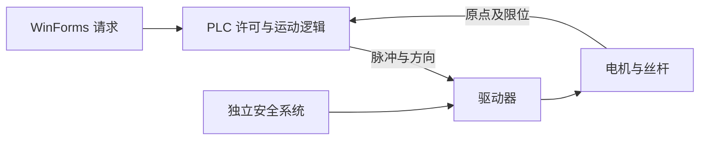

# 电机、脉冲、回零、限位与 Jog

> P0｜待学习 / 待验证｜原整理：2026-10-31；增量：2026-11-01。

一句话：控制器决定运动指令，驱动器调节电机能量，机构把旋转变位移，反馈和安全设计约束实际运动。

## 从电机到直线位移

电机把电能转换为机械运动；驱动器按电机类型控制电流/电压。步进系统通常按脉冲推进磁场，开环时不能保证未失步；伺服通常结合编码器做闭环，可工作在位置、速度、转矩模式。编码器测位置/速度，但不自动等于已建立机器绝对零点。变频器主要通过频率/电压等控制交流电机，不能等同于步进脉冲驱动器。

PUL/DIR 是一种脉冲+方向接口，ENA 是使能接口，其有效电平、是否可悬空、时序及电气要求依型号。还有双脉冲 CW/CCW 模式。A/B 相端子接电机绕组，不是给 PLC 发指令的端口。SW1–SW6 的功能、电流峰值/RMS 和细分表必须查该驱动器手册，不套用其他照片。

假设 1.8° 基本步距、8 细分、直连导程 5 mm 丝杆，无减速和失步：

- 360/1.8 = 200 整步/圈；200×8 = 1600 脉冲/圈。
- 每脉冲理论位移 5/1600 = 0.003125 mm。
- 走 10 mm 需 3200 脉冲；理论速度 20 mm/s 需 6400 Hz。

细分提高指令分辨率，不保证相同级别的机械精度；负载、加减速、间隙和共振影响结果。PLC 高速输出/运动模块负责脉冲时序，Windows 按键定时不能替代它。

## 电平、脉冲与步进驱动器

### 电平是什么

电平是某一时刻数字信号所处的电压状态。高电平、低电平是相对于接收端规定的阈值和电气接口而言，不能简单认为所有设备都以 24 V 表示 1、0 V 表示 0。逻辑 1/0 的业务含义也由接线和程序约定；高电平不天然等于“运行”。

### 脉冲是什么

脉冲是信号在一段时间内从一种电平变化到另一种电平再返回（或形成规定的有效跳变）。常见 PUL/DIR 接口通常按指定有效边沿计数，例如上升沿；具体计数边沿、最小高低电平宽度、输入电流和时序要求必须查驱动器手册。

- 电平：信号在某一时刻的状态。
- 上升沿：低电平变为高电平的瞬间。
- 下降沿：高电平变为低电平的瞬间。
- 脉冲数量：驱动器识别到的有效脉冲数，决定指令步数/位置增量。
- 脉冲频率：单位时间内的有效脉冲数，决定指令速度；还要考虑加减速曲线和驱动器/电机能力。

**不要把“一个高电平脉冲”理解成“给电机线圈通一次电”。** PUL 是驱动器的逻辑控制输入，不是电机绕组的动力电源。驱动器识别有效脉冲后，更新内部步进位置/电流目标，再由功率级控制 A、B 相绕组电流。

### 步进驱动器内部做什么

步进驱动器（Stepper Driver）是电机的专用控制与功率变换设备。典型工作过程：

1. 输入接口接收 PUL、DIR、ENA 等控制信号，并按设定识别脉冲有效沿。
2. 控制逻辑结合方向、细分和当前步进状态，更新目标电流矢量/微步位置。
3. 功率器件（常见为 MOSFET H 桥）按控制策略调节 A、B 两相绕组电流；常见斩波恒流驱动会用 PWM 快速开关并检测/限制绕组电流。
4. 定子绕组产生的合成磁场改变，转子趋向新的平衡位置，形成一步或一个微步的运动。

不同驱动器的电路、波形、细分算法和电流控制实现不同；以上是常见两相步进驱动器的概念模型，不代表照片中设备的具体电路拓扑。

没有新脉冲时，电机通常不会继续按脉冲指令推进，但驱动器可能仍给绕组提供保持电流以维持保持转矩；有些驱动器会在静止一段时间后自动降低保持电流，具体看参数设置。停止脉冲不等于驱动器断电，也不等于安全停止。

### PUL、DIR、ENA 与电机绕组

- \`PUL+ / PUL-\`：脉冲输入端。
- \`DIR+ / DIR-\`：方向输入端；哪种电平对应正方向由型号、接线和参数决定。
- \`ENA+ / ENA-\`：使能输入端；有效电平、是否必须接线、悬空行为依型号决定。
- \`A+ / A-\`、\`B+ / B-\`：两相电机绕组端子，连接电机，不是 PLC 的脉冲/方向信号端。
- \`VCC / GND\`：需结合面板标识和说明书确认其电源用途、极性及允许范围，不可仅凭端子名称推断接线。

PUL/DIR/ENA 输入可能采用光耦隔离等输入结构，但输入电路类型、共阳/共阴接法、差分/单端方式及兼容电压必须以具体驱动器和 PLC 输出规格为准。不能仅凭线色或端子名称推断 PLC 端子可以直接连接。

### 脉冲数量、细分与角度换算

对于步距角为 \`θ\` 的电机：

- 每圈整步数：\`N_full = 360° / θ\`。
- 驱动器细分为 \`m\` 时，理论每圈脉冲数：\`N_pulse = N_full × m\`。
- 输入 \`P\` 个有效脉冲的理论角度：\`angle = P × 360° / N_pulse\`。
- 脉冲频率为 \`f\` Hz 时，理想转速：\`rpm = f × 60 / N_pulse\`。

示例：假设电机步距角 1.8°（每圈 200 整步），驱动器设为 8 细分，则每圈理论需要 200×8=1600 个有效脉冲。输入 1000 个脉冲，理论角度为 \`1000×360/1600=225°\`。这只是指令分辨率的理想计算，假设未失步、脉冲均被正确识别、无减速机构；实际机械角度还受负载、共振、加减速、电机与驱动器能力、传动间隙等影响。

细分提高的是指令分辨率和平顺性，不保证机械精度按相同比例提高。微步角也不一定在各种负载下都能等比例、线性地实现。

### 方向、点动与回零如何串起来

在常见脉冲+方向控制方式中：

- 正转/反转：PLC 设置 DIR 状态，并按需要输出脉冲；高/低电平对应哪一方向需查设备配置。
- 点动（Jog）：按住时持续发出运动请求，PLC 依据速度、方向、许可和限位输出脉冲；松开后撤销请求并按控制程序减速/停止。
- 定位：PLC 按目标位置换算脉冲数量，并按速度/加速度规划输出脉冲。
- 回零：PLC 执行回零搜索与定位流程，读取原点输入并建立坐标参考；回零请求位的短脉冲不是电机运动脉冲，也不代表回零已完成。

C# 上位机写入 \`M\` 区位（例如某个回零/点动请求位），只是改变 PLC 内部状态；是否产生高速脉冲由 PLC 程序/运动控制功能决定。\`M0.0\` 不是物理脉冲端子。\`Q0.x\` 也只能作为地址示例，不能在未核对 PLC 型号、晶体管/继电器输出类型、PTO 通道分配和接线前认定为实际 PUL/DIR 输出。

## 本次实训台驱动器照片识读（型号与接线待核实）

根据用户于 2026-11-01 提供的照片，可直接观察到：

- 控制柜内有两台贴有“步进驱动1”“步进驱动2”标签的黑色驱动器；照片不能证明两台的型号、参数完全相同。
- 一台驱动器特写面板可见 \`ENA- / ENA+\`、\`DIR- / DIR+\`、\`PUL- / PUL+\`、\`B- / B+\`、\`A- / A+\`、\`GND\`、\`VCC\` 标识。
- 面板印有 \`DC: 9~42VDC\` 字样；具体供电端子定义、允许电源范围及接线方式仍应以完整型号说明书为准。
- 面板的细分表可读到以下档位（S1–S3）：

| 细分 | 标注脉冲数/圈 | S1 | S2 | S3 |
|---:|---:|---|---|---|
| 1 | 200 | ON | ON | OFF |
| 2/A | 400 | ON | OFF | ON |
| 2/B | 400 | OFF | ON | ON |
| 4 | 800 | ON | OFF | OFF |
| 8 | 1600 | OFF | ON | OFF |
| 16 | 3200 | OFF | OFF | ON |
| 32 | 6400 | OFF | OFF | OFF |

- 面板还印有 \`Current(A) / PKCurrent\` 与 S4–S6 的电流设置表。照片不足以确认这些电流数值的 RMS/峰值定义，也无法确认当前拨码开关实际处于哪一档。

**尚未确认，不能据此下结论：**驱动器完整型号；电机步距角、额定相电流；S1–S6 当前实际状态；PLC 的实际 PTO/PUL/DIR 地址；PLC 输出是 PNP、NPN、差分还是其他形式；PUL/DIR/ENA 的实际接线、有效电平和时序；VCC/GND 的具体接线；两台驱动器的参数是否相同。照片中的线色不能作为接线依据。

实操前先断电并按老师/设备手册流程确认；不要带电拆接端子或随意拨动 S1–S6。先核对电机铭牌、驱动器完整型号手册、PLC 输出规格和电气图，再确认电源、信号共地/隔离、输入电流及接线方式。

## 回零、限位和停止

原点开关为建立坐标参考提供信号，限位用于约束行程；回零通常有搜索、离开、低速再接近及偏移等步骤，具体由 PLC 运动程序决定。200 ms 的回零请求只表示写位后延时复位，不是电机 200 ms 内回零完成，也不是固定精度脉冲。

Jog 是手动点动，按住请求沿选定方向运动，释放请求停止；“正”方向是坐标约定，不一定物理向右。上位机先发速度再发方向位，PLC 应检查许可、正反互锁、限位、故障和指令有效期。不能仅靠 UI 禁用按钮避免冲突。

常闭链路常用于令断线趋向禁止，但短路、传感器故障、软件反相等仍需诊断；灯亮可能表示供电或输出，不能推出梯形图触点极性。普通限位输入不自动成为安全功能。急停、安全限位与驱动安全功能须由适当硬件/安全控制设计承担。

通信看门狗检查命令/心跳的新鲜度，失联按设备定义处理；反馈区分请求已写、PLC 已接受、轴运行、轴停止、回零完成。普通输出回读也不能证明机构实际停止。硬件互锁在电气层限制冲突动作，软件互锁用于逻辑协调，两者职责不同。

## 典型故障分析与自测

请求位写 true 后超时，可能是成功但应答丢失，不能直接认定没有启动。释放后写 false 失败，状态应标“停止未确认”，不能仅显示空闲。窗体退出或电脑掉电后无法保证补发，必须分析 PLC/驱动器的失联行为。[原项目分析](../04-Industrial-Projects/Dual-Axis-Jog.md)记录了现有实现边界。

自测：解释 1600 脉冲/圈为什么不能直接推出 mm；列出“网络断线仍运动”时上位机、PLC、驱动器各需观察的证据。

## 官方图文

[Oriental Motor：步进电机技术手册](https://www.orientalmotor.eu/system/files/document/tech/technicalmanual_stepping_10e.pdf)提供电机/驱动器、脉冲及机构的教学插图；[步进原理](https://www.orientalmotor.com/stepper-motors/technology/stepper-motor-overview.html)用于概念阅读。厂商示例不证明课堂驱动器的型号与接线。
