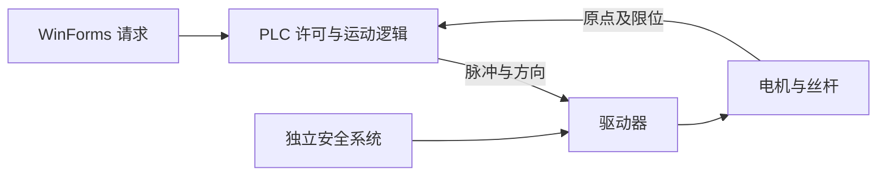

# 电机、脉冲、回零、限位与 Jog

> P0｜待学习｜2026-10-31｜Q019–020、Q024–027、Q048、Q050–052、Q054、Q056。

一句话：控制器决定运动指令，驱动器调节电机能量，机构把旋转变位移，反馈和安全设计约束实际运动。

## 从电机到直线位移

电机把电能转换为机械运动；驱动器按电机类型控制电流/电压。步进系统通常按脉冲推进磁场，开环时不能保证未失步；伺服通常结合编码器做闭环，可工作在位置、速度、转矩模式。编码器测位置/速度，但不自动等于已建立机器绝对零点。变频器主要通过频率/电压等控制交流电机，不能等同于步进脉冲驱动器。

PUL/DIR 是一种脉冲+方向接口，ENA 是使能接口，其有效电平、是否可悬空、时序及电气要求依型号。还有双脉冲 CW/CCW 模式。A/B 相端子接电机绕组，不是给 PLC 发指令的端口。SW1–SW6 的功能、电流峰值/RMS 和细分表必须查该驱动器手册，不套用其他照片。

假设 1.8° 基本步距、8 细分、直连导程 5 mm 丝杆，无减速和失步：

- 360/1.8 = 200 整步/圈；200×8 = 1600 脉冲/圈。
- 每脉冲理论位移 5/1600 = 0.003125 mm。
- 走 10 mm 需 3200 脉冲；理论速度 20 mm/s 需 6400 Hz。

细分提高指令分辨率，不保证相同级别的机械精度；负载、加减速、间隙和共振影响结果。PLC 高速输出/运动模块负责脉冲时序，Windows 按键定时不能替代它。

## 回零、限位和停止

原点开关为建立坐标参考提供信号，限位用于约束行程；回零通常有搜索、离开、低速再接近及偏移等步骤，具体由 PLC 运动程序决定。200 ms 的回零请求只表示写位后延时复位，不是电机 200 ms 内回零完成，也不是固定精度脉冲。

Jog 是手动点动，按住请求沿选定方向运动，释放请求停止；“正”方向是坐标约定，不一定物理向右。上位机先发速度再发方向位，PLC 应检查许可、正反互锁、限位、故障和指令有效期。不能仅靠 UI 禁用按钮避免冲突。

常闭链路常用于令断线趋向禁止，但短路、传感器故障、软件反相等仍需诊断；灯亮可能表示供电或输出，不能推出梯形图触点极性。普通限位输入不自动成为安全功能。急停、安全限位与驱动安全功能须由适当硬件/安全控制设计承担。

通信看门狗检查命令/心跳的新鲜度，失联按设备定义处理；反馈区分请求已写、PLC 已接受、轴运行、轴停止、回零完成。普通输出回读也不能证明机构实际停止。硬件互锁在电气层限制冲突动作，软件互锁用于逻辑协调，两者职责不同。

## 典型故障分析与自测

请求位写 true 后超时，可能是成功但应答丢失，不能直接认定没有启动。释放后写 false 失败，状态应标“停止未确认”，不能仅显示空闲。窗体退出或电脑掉电后无法保证补发，必须分析 PLC/驱动器的失联行为。[原项目分析](../04-Industrial-Projects/Dual-Axis-Jog.md)记录了现有实现边界。

自测：解释 1600 脉冲/圈为什么不能直接推出 mm；列出“网络断线仍运动”时上位机、PLC、驱动器各需观察的证据。

## 官方图文

[Oriental Motor：步进电机技术手册](https://www.orientalmotor.eu/system/files/document/tech/technicalmanual_stepping_10e.pdf)提供电机/驱动器、脉冲及机构的教学插图；[步进原理](https://www.orientalmotor.com/stepper-motors/technology/stepper-motor-overview.html)用于概念阅读。厂商示例不证明课堂驱动器的型号与接线。
