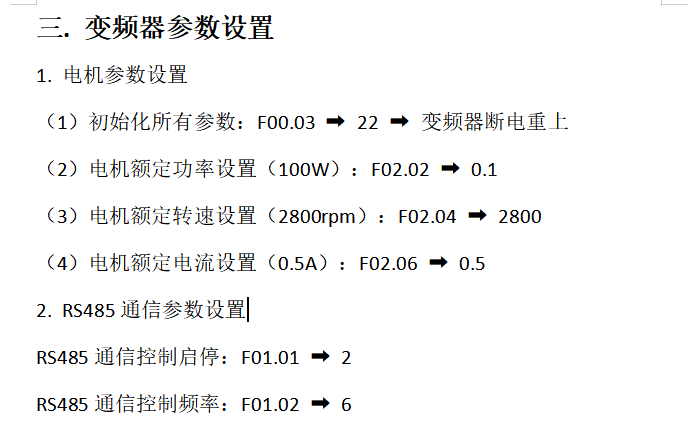

# 问题：
1. 假设步进轴正在快速寻找原点，突然检测到原点开关。为什么不直接把当前位置设为 0，而是还要反向退出，再低速寻找一次？
2. 原点开关\左右限位开关是个开关是用来干啥的？他不应该是传感器吗？
3. 滚珠丝杆和梯形丝杆的区别
4. 驱动器给步进电机提供多大的相电流能决定什么？
5. 怎么监控具体变量（状态图）

## 八、下一步我建议你研究这三个程序页

不要急着看完整个项目，我们按实际设备控制逻辑来学：

1. 初始化：PLC 上电后，如何初始化轴、使能驱动器？

2. 步进轴1：如何实现绝对定位、相对定位、点动和停止？

3. 伺服轴2：PLC 控制伺服电机与步进电机有什么区别？

我建议下一张先发 「初始化」标签页的截图。

因为你现在看到的 GOTO 指令依赖前面的轴初始化。如果初始化没弄明白，就容易出现程序写了运动命令，但电机根本不动的情况。
![[todo-1793609218136.webp]]

# 老师布置任务：

变频器控制正转反转，先设置频率, 不同频率动起来。写值用 short

![[todo-1793620677773.webp]]
